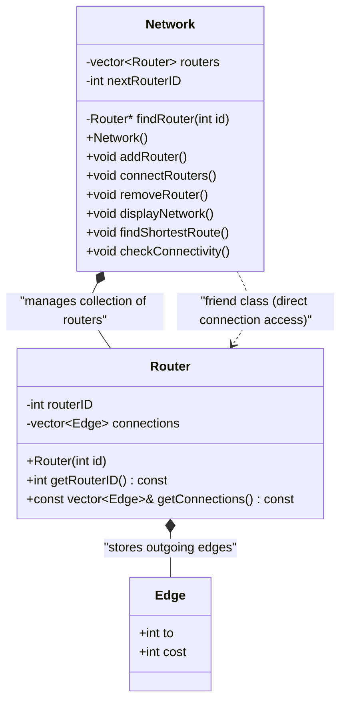

# NetRoute Simulator — Object-Oriented Design

## 1. Architectural Overview

**NetRoute Simulator** is designed as a clean, modular, and beginner-friendly Object-Oriented C++ application. It models a dynamic computer network of routers and weighted communication links, adhering to core Object-Oriented Programming (OOP) principles while avoiding unnecessary enterprise overhead or frameworks.

The system is decomposed into three logical entities:
1. **`Edge` struct**: A lightweight Plain Old Data (POD) record representing a connection to an adjacent router with an associated transmission cost.
2. **`Router` class**: Encapsulates an individual router node's identity and outgoing connections.
3. **`Network` class**: The central controller that manages the collection of routers, link establishment, topology queries, pathfinding, and connectivity checks.
4. **`main()` function**: The presentation layer driving the interactive menu loop and dispatching user actions to `Network` methods.

---

## 2. Class Diagram

---

## 3. Class Responsibilities & API Design

### `struct Edge`
- **Header**: [Router.h](file:///f:/DEV/NetRouteSimulator/Router.h)
- **Role**: Lightweight data record representing an outgoing link.
- **Attributes**:
  - `int to`: The ID of the adjacent router.
  - `int cost`: Positive transmission cost of the link.
- **Design Rationale**: Plain Old Data (POD) structure with public members; no internal state invariants or complex behavior to hide.

### `class Router`
- **Header / Source**: [Router.h](file:///f:/DEV/NetRouteSimulator/Router.h), [Router.cpp](file:///f:/DEV/NetRouteSimulator/Router.cpp)
- **Role**: Encapsulates an individual router node.
- **Private Data Members**:
  - `int routerID`: Unique identifier for the router.
  - `vector<Edge> connections`: List of links incident to this router.
- **Friend Declaration**:
  - `friend class Network`: Permits `Network` to manage `connections` directly during link creation and deletion without exposing public mutators.
- **Public Methods**:
  - `Router(int id)`: Constructor initializing the router with a unique ID.
  - `int getRouterID() const`: Const accessor returning the router's ID.
  - `const vector<Edge>& getConnections() const`: Const reference accessor returning the router's connection list.

### `class Network`
- **Header / Source**: [Network.h](file:///f:/DEV/NetRouteSimulator/Network.h), [Network.cpp](file:///f:/DEV/NetRouteSimulator/Network.cpp)
- **Role**: Manages the network topology, validates user operations, and executes graph algorithms.
- **Private Data Members**:
  - `vector<Router> routers`: Collection of all active router objects in the network.
  - `int nextRouterID`: Counter tracking the next automatic integer ID (`1, 2, 3...`).
- **Private Member Functions**:
  - `Router* findRouter(int id)`: Helper method performing linear search for a router by its ID, returning a pointer to the router or `nullptr` if not found.
- **Public Member Functions**:
  - `Network()`: Constructor initializing `nextRouterID = 1`.
  - `void addRouter()`: Creates and registers a new `Router` instance.
  - `void connectRouters()`: Prompts for two router IDs and cost, validates them, and establishes a bidirectional link.
  - `void removeRouter()`: Removes a specified router and purges all incoming/outgoing connections to it across the network.
  - `void displayNetwork()`: Prints the entire network topology, highlighting connected neighbors and isolated routers.
  - `void findShortestRoute()`: Computes and displays the lowest-cost path between two routers using Dijkstra's algorithm.
  - `void checkConnectivity()`: Verifies whether all routers are reachable from each other using Breadth-First Search (BFS).

---

## 4. OOP Principles Implemented

| Principle | Implementation in NetRoute Simulator | Code Location |
| :--- | :--- | :--- |
| **Classes & Objects** | Real-world network entities are modeled as explicit C++ classes (`Router` and `Network`). | [Router.h](file:///f:/DEV/NetRouteSimulator/Router.h), [Network.h](file:///f:/DEV/NetRouteSimulator/Network.h) |
| **Encapsulation** | State variables (`routerID`, `connections`, `routers`, `nextRouterID`) are declared `private`. Internal data is shielded against direct modification from outside callers. | [Router.h](file:///f:/DEV/NetRouteSimulator/Router.h), [Network.h](file:///f:/DEV/NetRouteSimulator/Network.h) |
| **Data Hiding** | The internal graph representations, indexing mechanics, and algorithmic structures (`visited`, `parent`, `distance`, priority queues) are concealed within member functions. | [Network.cpp](file:///f:/DEV/NetRouteSimulator/Network.cpp) |
| **Friend Class** | `Router` declares `friend class Network;`. This allows `Network` to modify `connections` directly during link creation and deletion without exposing public setters to `main()` or other external code. | [Router.h](file:///f:/DEV/NetRouteSimulator/Router.h#L21-L22) |
| **Composition & Aggregation** | `Network` has a collection of `Router` objects (`vector<Router>`), and each `Router` has a collection of `Edge` objects (`vector<Edge>`). | [Network.h](file:///f:/DEV/NetRouteSimulator/Network.h#L15), [Router.h](file:///f:/DEV/NetRouteSimulator/Router.h#L19) |
| **Abstraction** | `main()` only interacts with high-level public member functions (`network.addRouter()`, `network.findShortestRoute()`, etc.) without needing knowledge of internal graph structures or algorithmic mechanics. | [main.cpp](file:///f:/DEV/NetRouteSimulator/main.cpp) |
| **Separation of Concerns** | `main()` handles user interaction and the menu loop; `Network` handles network state and algorithms; `Router` encapsulates router-level state. | [main.cpp](file:///f:/DEV/NetRouteSimulator/main.cpp), [Network.cpp](file:///f:/DEV/NetRouteSimulator/Network.cpp), [Router.cpp](file:///f:/DEV/NetRouteSimulator/Router.cpp) |

---

## 5. Algorithmic Architecture

### 1. Dijkstra's Shortest Path Algorithm
- **Location**: `Network::findShortestRoute()` in [Network.cpp](file:///f:/DEV/NetRouteSimulator/Network.cpp)
- **Data Structures**:
  - `vector<int> distance(nextRouterID, INF)`: Tracks the minimum tentative cost to each router.
  - `vector<int> parent(nextRouterID, -1)`: Stores predecessor routers to reconstruct the shortest path.
  - `vector<bool> visited(nextRouterID, false)`: Tracks evaluated routers.
  - `priority_queue<pair<int, int>, vector<pair<int, int>>, greater<pair<int, int>>> pq`: Min-priority queue ordered by path cost.
- **Process**:
  1. Initialize `distance[source] = 0` and push `{0, source}` to `pq`.
  2. Pop the router with lowest cost. If already visited, skip; otherwise mark visited.
  3. Relax outgoing edges: if `currentCost + edge.cost < distance[edge.to]`, update `distance` and `parent`, and push to `pq`.
  4. Backtrack using `parent` from destination to source to output the exact hop sequence.

### 2. Network Connectivity (Breadth-First Search)
- **Location**: `Network::checkConnectivity()` in [Network.cpp](file:///f:/DEV/NetRouteSimulator/Network.cpp)
- **Data Structures**:
  - `vector<int> visited(nextRouterID, 0)`: Tracks visited nodes.
  - `queue<int> q`: Standard FIFO queue for breadth-first exploration.
- **Process**:
  1. Starts at the first router in `routers`.
  2. Traverses all reachable neighbors iteratively.
  3. Increments a visited `count`.
  4. If `count == routers.size()`, the network is fully **CONNECTED**; otherwise, it is **DISCONNECTED** (partitioned).

### 3. Safe Node Deletion (Erase-Remove Idiom)
- **Location**: `Network::removeRouter()` in [Network.cpp](file:///f:/DEV/NetRouteSimulator/Network.cpp)
- **Process**:
  1. Iterates over all active routers and uses `std::remove_if` to remove any connection where `edge.to == id`.
  2. Uses `std::remove_if` on the `routers` vector to remove the `Router` instance with matching ID.
  3. Prevents dangling references and orphaned edges.

---

## 6. Design Decisions & Rationale

### Why a dedicated `Router` class is used
In earlier prototypes, the network was stored simply as an adjacency list of integer indices (`vector<vector<Edge>>`). Introducing an explicit `Router` class:
- Accurately models the domain entity (a router in a physical network).
- Encapsulates router-specific attributes (`routerID` and its incident `connections`).
- Demonstrates C++ Object-Oriented principles (Encapsulation, Const-correct Accessors, and Friendship).

### Why Friendship (`friend class Network`) was chosen
- Router connections are modified exclusively through network-level operations (`connectRouters()` and `removeRouter()`).
- Exposing a public setter like `addConnection()` on `Router` would allow external callers (`main()`) to create unbalanced, unidirectional, or unvalidated links.
- Declaring `friend class Network;` keeps the connection list strictly private from the outside world while giving the `Network` orchestrator direct, efficient access.

### Why Inheritance and Polymorphism were omitted
- All routers in this simulator adhere to identical behavior and structure.
- There are no specialized hardware types (e.g., WirelessRouter, FiberSwitch) requiring subclassing or virtual table dispatch.
- Adding abstract base classes would be overengineering and violate the **YAGNI** (*You Aren't Gonna Need It*) principle.
