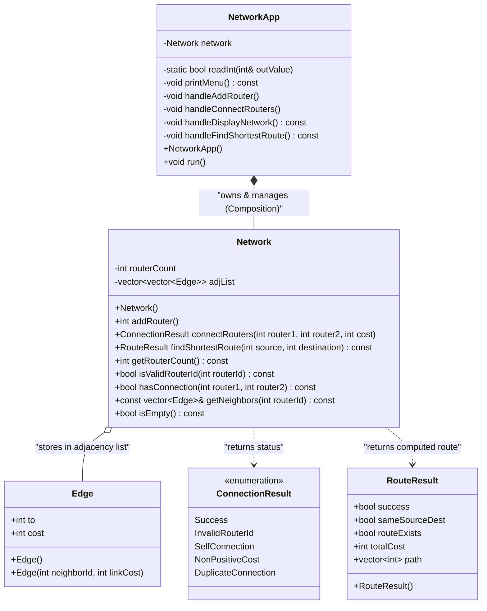
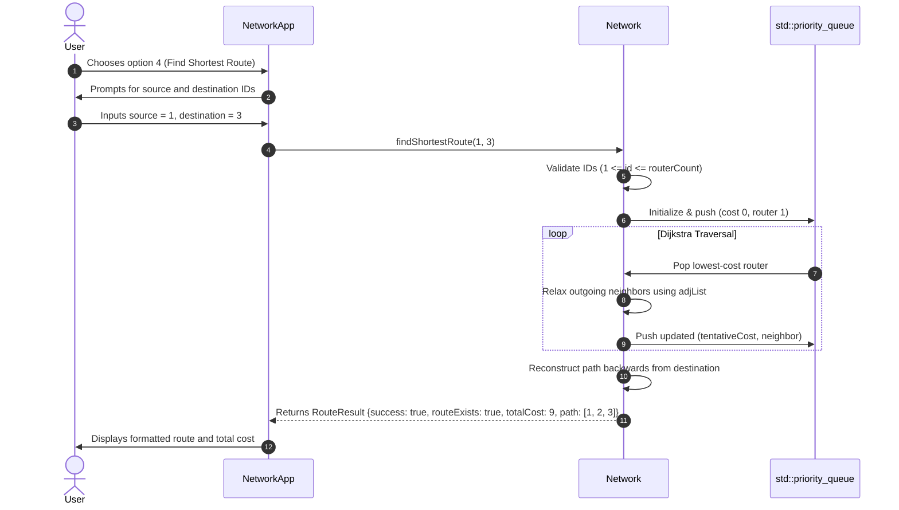

# NetRoute Simulator — Object-Oriented Design & Architecture

## 1. Architectural Overview

**NetRoute Simulator** is refactored from a procedural script into a clean, modular, object-oriented C++17 system. The system enforces strict separation of concerns across distinct layers:

1. **Domain Model (`Network.h`, `Network.cpp`)**:
   - Represents the core network graph, router connections, topology queries, and Dijkstra's shortest-path algorithm.
   - Completely decoupled from console I/O (`std::cin` / `std::cout`).
   - Communicates results and statuses via typed data structures (`RouteResult`, `ConnectionResult`).

2. **Application / Presentation Layer (`main.cpp`)**:
   - Encapsulated within `class NetworkApp`.
   - Manages interactive console menus, formatted displays, and user-input validation/recovery.
   - Interacts with the domain model exclusively through the public API of `Network`.

3. **Verification Suite (`tests.cpp`)**:
   - Independent automated test harness validating all network operations, error conditions, and algorithm edge cases.

---

## 2. Mermaid Class Diagram

---

## 3. Class Relationships and Component Roles

### A. `struct Edge`
- **Role**: Simple value object representing a link to a neighboring router.
- **Attributes**:
  - `int to`: Target router ID.
  - `int cost`: Transmission cost / weight of the link.
- **Design Rationale**: In C++, a `struct` is the idiomatic way to model Plain Old Data (POD) records where all fields are passively accessed. Wrapping fields in private members with boilerplate getters/setters (`getTo()`, `getCost()`) would add unnecessary syntax without providing any invariant enforcement.

### B. `enum class ConnectionResult`
- **Role**: Strongly-typed status enumeration for link creation requests.
- **Values**: `Success`, `InvalidRouterId`, `SelfConnection`, `NonPositiveCost`, `DuplicateConnection`.
- **Design Rationale**: Eliminates string-based error handling or console prints inside the domain class. Allows `Network::connectRouters` to remain a pure model function that can be tested programmatically.

### C. `struct RouteResult`
- **Role**: Encapsulates the complete result of Dijkstra's algorithm.
- **Attributes**:
  - `bool success`: Source and destination exist in the network.
  - `bool sameSourceDest`: Source equals destination (cost is 0).
  - `bool routeExists`: Whether an active path connects source to destination.
  - `int totalCost`: Sum of link weights along the shortest path.
  - `std::vector<int> path`: Ordered sequence of router IDs from source to destination.
- **Design Rationale**: Decouples the routing calculation from output formatting. The UI or test harness can inspect paths and costs without needing to parse console strings.

### D. `class Network`
- **Role**: Primary domain class that encapsulates all network state and operations.
- **Private State**:
  - `int routerCount`: Tracks total routers; prevents external modification.
  - `std::vector<std::vector<Edge>> adjList`: Adjacency list storing outgoing links for each router.
- **Public Interface**:
  - `int addRouter()`: Safe incremental ID assignment.
  - `ConnectionResult connectRouters(...)`: Validates and inserts bidirectional links.
  - `RouteResult findShortestRoute(...)`: Executes Dijkstra's algorithm.
  - Inspection methods (`getRouterCount`, `isValidRouterId`, `hasConnection`, `getNeighbors`, `isEmpty`).

### E. `class NetworkApp`
- **Role**: Controller and presentation coordinator.
- **Composition**: Owns a single `Network` instance (`NetworkApp` *has-a* `Network`).
- **Responsibilities**:
  - Displays menus and prompts.
  - Validates and sanitizes user input (handling non-numeric inputs and EOF).
  - Translates user requests into `Network` operations.
  - Formats domain results (`RouteResult`, `ConnectionResult`, topology) for terminal display.

---

## 4. Why a Separate `Router` Class Was NOT Created

During architectural analysis, we evaluated whether to create an individual `Router` class (e.g., `class Router`). We determined that a separate `Router` class is **not justified** for the following reasons:

1. **No Unique Router State**: Routers in this simulator do not possess distinct properties (such as MAC addresses, firmware versions, or IP routing tables) beyond an auto-incremented integer ID (`1, 2, ..., N`).
2. **Avoids Empty Wrappers**: A class like `class Router { int id; };` is a trivial wrapper that adds indirection and syntactic noise without encapsulating meaningful behavior.
3. **Graph Memory Locality**: Grouping edges into `std::vector<std::vector<Edge>>` provides contiguous cache locality for graph traversal. Splitting this into individual `Router` objects on the heap would degrade traversal performance and complicate Dijkstra's algorithm without architectural benefit.
4. **Adherence to Core Objectives**: The project requirements emphasize avoiding artificial classes created solely to inflate class counts.

---

## 5. Why Inheritance and Polymorphism Are Omitted

1. **Inheritance ("is-a" relationship)**:
   - Inheritance is appropriate when modeling a hierarchy of specialized subtypes (e.g., `WirelessRouter extends Router`, `FiberLink extends Link`).
   - In NetRoute Simulator, all routers behave identically, and all links are homogeneous bidirectional weighted edges.
   - Introducing an abstract base class would be speculative and create unnecessary complexity (violating YAGNI: *You Aren't Gonna Need It*).

2. **Polymorphism (Dynamic Dispatch via Virtual Functions)**:
   - Virtual methods introduce runtime vtable lookups and pointer indirection.
   - Because there is only one routing algorithm (Dijkstra) and one graph topology model, compile-time static dispatch is faster, safer, and much simpler to understand during college vivas.

---

## 6. Mapping of OOP Principles to Implementation

| OOP Principle | Implementation in NetRoute Simulator | Concrete Code Evidence |
| :--- | :--- | :--- |
| **Encapsulation** | Network state (`routerCount`, `adjList`) is strictly `private`. External entities cannot tamper with router IDs or inject invalid edges directly. State changes are guarded by validation functions. | [`Network.h`](file:///f:/DEV/NetRouteSimulator/Network.h): `private: int routerCount; std::vector<std::vector<Edge>> adjList;` |
| **Data Hiding** | The internal 1-based indexing and vector-of-vectors layout of `adjList` are hidden from `NetworkApp` and test harnesses. | [`Network.cpp`](file:///f:/DEV/NetRouteSimulator/Network.cpp): All modifications occur via `addRouter()` and `connectRouters()`. |
| **Abstraction** | Users of `Network` interact with high-level conceptual actions (`addRouter()`, `connectRouters()`, `findShortestRoute()`) without knowing how Dijkstra's min-priority queue or relaxation steps are implemented. Interface is cleanly declared in `Network.h` and defined in `Network.cpp`. | [`Network.h`](file:///f:/DEV/NetRouteSimulator/Network.h): Public interface; [`NetworkApp.cpp`](file:///f:/DEV/NetRouteSimulator/main.cpp): Calls `network.findShortestRoute(src, dst)`. |
| **Composition** | `NetworkApp` owns and controls the lifetime of a `Network` instance (`NetworkApp` *has-a* `Network`). | [`main.cpp`](file:///f:/DEV/NetRouteSimulator/main.cpp): `class NetworkApp { private: Network network; ... };` |
| **Separation of Concerns** | Domain logic (graph representation, algorithm) is completely isolated from I/O presentation (`cin`/`cout`). Result structures (`RouteResult`, `ConnectionResult`) communicate outcomes. | `Network.cpp` contains 0 calls to `std::cout` or `std::cin`. All I/O is isolated in `NetworkApp` in `main.cpp`. |
| **Strong Typing** | Scoped enumerations (`enum class ConnectionResult`) replace magic error integers or string flags. | [`Network.h`](file:///f:/DEV/NetRouteSimulator/Network.h): `enum class ConnectionResult { ... };` |

---

## 7. Sequence Diagram: Finding Shortest Route

