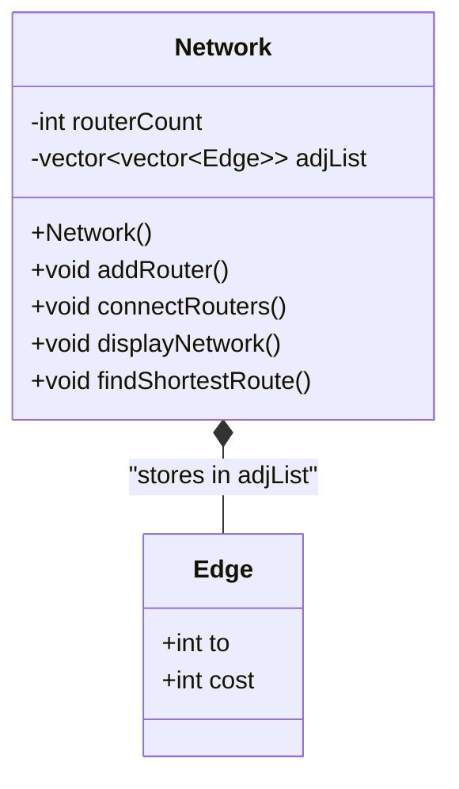

# NetRoute Simulator — Object-Oriented Design

## 1. Architectural Overview

**NetRoute Simulator** is designed as a clean, simple, and beginner-friendly Object-Oriented C++ application. It avoids unnecessary abstractions, helper frameworks, or enterprise complexity, making it ideal for a college-level C++ OOP project.

The application consists of:
1. **`Edge` struct**: A lightweight data record representing a connection to a neighboring router.
2. **`Network` class**: The primary OOP class that encapsulates the network data (number of routers and adjacency list) and provides public member functions for managing routers, connections, and finding the shortest route.
3. **`main()` function**: The driver function that displays the menu, handles user choices via simple `cin` / `cout`, and calls `Network` methods.

---

## 2. Class Diagram

---

## 3. Class Responsibilities

### `struct Edge`
- **Purpose**: Stores the destination router ID (`to`) and the link weight (`cost`).
- **Why a struct**: It is a passive data record (Plain Old Data) with public members. Using a struct avoids unnecessary boilerplate getters and setters.

### `class Network`
- **Purpose**: Encapsulates the complete network topology and Dijkstra's shortest-path algorithm.
- **Private Data Members**:
  - `int routerCount`: Tracks the total number of routers.
  - `vector<vector<Edge>> adjList`: Adjacency list storing outgoing connections for each router.
- **Public Member Functions**:
  - `Network()`: Constructor to initialize an empty network with 1-based indexing.
  - `void addRouter()`: Adds a new router with an automatically incremented ID.
  - `void connectRouters()`: Prompts for two router IDs and a cost, validates them, and creates a bidirectional link.
  - `void displayNetwork()`: Prints the entire network topology, including isolated routers.
  - `void findShortestRoute()`: Prompts for source/destination and computes the shortest route using Dijkstra's algorithm.

---

## 4. OOP Principles Implemented

| Principle | Implementation in NetRoute Simulator | Code Location |
| :--- | :--- | :--- |
| **Encapsulation** | `routerCount` and `adjList` are `private` data members. They cannot be modified directly from outside the class. All changes must go through public member functions. | `Network.h` (private section) |
| **Data Hiding** | The internal graph representation (1-based vector of vectors) and Dijkstra data structures (`distance`, `parent`, `visited`) are hidden from `main()`. | `Network.cpp` |
| **Abstraction** | `main()` interacts with simple, high-level operations (`network.addRouter()`, `network.connectRouters()`, etc.) without needing to know graph traversal details. | `main.cpp` |
| **Separation of Concerns** | `main()` manages the menu loop and user choice selection, while `Network` handles all network simulation and routing logic. | `main.cpp` & `Network.cpp` |

---

## 5. Design Decisions

### Why a separate `Router` class was not created
Routers in this project only have an integer ID (`1, 2, ...`). Creating a `class Router` would merely wrap an integer without adding any useful behavior. Keeping routers as integer IDs indexed in `vector<vector<Edge>>` provides fast array access, better memory locality, and simpler code.

### Why Inheritance and Polymorphism were omitted
- **Inheritance** models an "is-a" relationship (e.g., `WirelessRouter` vs `WiredRouter`). Here, all routers and links are identical.
- **Polymorphism** (virtual functions) is used when different objects respond to the same function call in different ways at runtime. Here, there is only one network type and one routing algorithm (Dijkstra).
- Omitting them avoids unnecessary complexity and adheres to the **YAGNI** (*You Aren't Gonna Need It*) principle.
