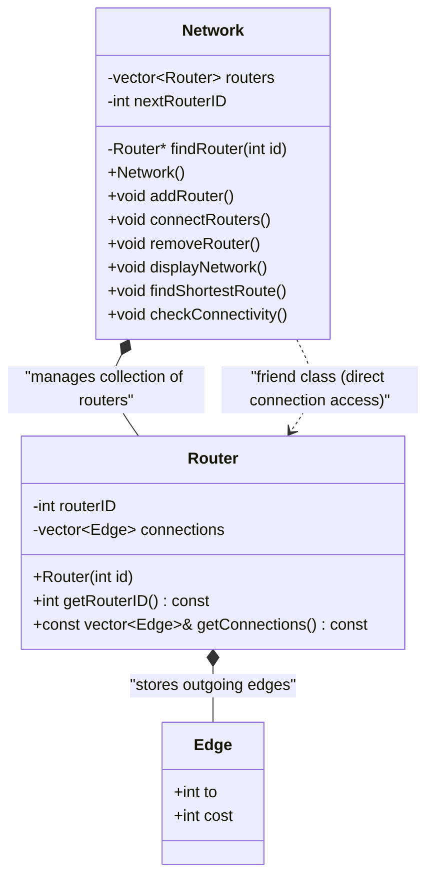

# NETROUTE SIMULATOR

A lightweight, clean Object-Oriented C++ Network Routing Simulator written in standard C++17. Designed specifically for college Object-Oriented Programming (OOP) and Data Structures demonstrations, vivas, and lab examinations.

---

## 1. Project Overview

**NetRoute Simulator** models a computer network of routers connected by bidirectional, weighted communication links. It allows users to:
1. Dynamically add routers with automatically assigned incremental integer IDs (`1, 2, 3, ...`).
2. Establish communication links between routers with custom positive costs.
3. Remove routers and automatically purge all associated connections across the network.
4. Visualize the entire network topology, highlighting both connected and isolated routers.
5. Calculate and display the optimal shortest path and minimum transmission cost between any two routers using **Dijkstra's Algorithm**.
6. Verify global network connectivity using **Breadth-First Search (BFS)** to determine if all routers can communicate with one another.

The project demonstrates core Object-Oriented Programming (OOP) principles—including **Classes & Objects**, **Encapsulation**, **Data Hiding**, **Friendship (`friend class`)**, **Composition**, and **Abstraction**—while remaining simple, readable, and free of unnecessary enterprise boilerplate.

---

## 2. Interactive CLI Menu

The application provides an intuitive command-line interface:

```text
========================================
          NETROUTE SIMULATOR
========================================
1. Add Router
2. Connect Routers
3. Remove Router
4. Display Network
5. Find Shortest Route
6. Check Network Connectivity
0. Exit
========================================
Enter your choice: 
```

---

## 3. Features & Validation Rules

- **Option 1: Add Router**
  - Instantiates a new `Router` object with an auto-incremented ID starting at `1`.
  - Appends the router to the network's internal collection (`vector<Router>`).
  - Confirms addition: `Router added successfully with ID: <id>`.

- **Option 2: Connect Routers**
  - Prompts for two router IDs and a link transmission cost.
  - Links are bidirectional (traffic flows both ways).
  - **Validation checks:**
    - Rejects IDs if either router does not exist (`Error: One or both router IDs do not exist.`).
    - Rejects self-loops (`Error: Cannot connect a router to itself.`).
    - Rejects non-positive link costs ($\le 0$) (`Error: Link cost must be positive.`).
    - Rejects duplicate connections between already connected routers (`Error: Connection already exists.`).

- **Option 3: Remove Router**
  - Prompts for the router ID to remove.
  - Validates that the router exists in the network.
  - Automatically cleans up and deletes all incoming and outgoing connections referencing this router across all other routers using `std::remove_if`.
  - Removes the router instance from the network.

- **Option 4: Display Network**
  - Prints the complete network topology router by router.
  - Displays each router ID and its list of connected neighbors with link costs.
  - Clearly identifies isolated routers (`[No connections (Isolated)]`).
  - Warns if the network is empty.

- **Option 5: Find Shortest Route**
  - Prompts for source and destination router IDs.
  - Validates that both router IDs exist.
  - Handles the case where source equals destination directly (Path: `source`, Cost: `0`).
  - Executes **Dijkstra's Algorithm** using an STL min-priority queue (`std::priority_queue` with `greater<pair<int, int>>`).
  - Prints the sequence of router hops (e.g., `1 -> 2 -> 3`) and the total cumulative cost.
  - Detects unreachable destinations (`No route exists between these routers.`).

- **Option 6: Check Network Connectivity**
  - Evaluates whether the entire network forms a single connected component using **Breadth-First Search (BFS)** starting from the first router.
  - Traverses all reachable routers and counts visited nodes.
  - Reports `CONNECTED` if all routers are reachable from each other, or `DISCONNECTED` if partitions/isolated subnets exist.

- **Option 0: Exit**
  - Gracefully terminates the program.

---

## 4. Object-Oriented Architecture

The project is modularized into dedicated header and implementation files:

```text
NetRouteSimulator/
├── Router.h           # Edge struct and Router class declaration
├── Router.cpp         # Router class implementation
├── Network.h          # Network class declaration
├── Network.cpp        # Network class implementation (graph logic & algorithms)
├── main.cpp           # CLI driver and interactive menu loop
├── OOP_DESIGN.md      # Detailed OOP architectural specification
└── README.md          # Comprehensive project documentation & viva guide
```

### Class Diagram:



### Component Breakdown:

1. **`struct Edge`** (`Router.h`):
   - Represents a directed connection endpoint with `to` (neighbor router ID) and `cost` (link weight).
   - Designed as a lightweight Plain Old Data (POD) struct.

2. **`class Router`** (`Router.h`, `Router.cpp`):
   - Encapsulates an individual router entity.
   - Private attributes: `routerID` and `connections` (`vector<Edge>`).
   - Public accessors: `getRouterID()` and `getConnections()`.
   - Grants friendship to `Network` (`friend class Network;`), allowing the network controller to manage links directly while shielding them from external modification.

3. **`class Network`** (`Network.h`, `Network.cpp`):
   - Manages the overall network state and graph operations.
   - Private attributes: `routers` (`vector<Router>`) and `nextRouterID`.
   - Private helper: `Router* findRouter(int id)` for ID lookup.
   - Public methods: `addRouter()`, `connectRouters()`, `removeRouter()`, `displayNetwork()`, `findShortestRoute()`, and `checkConnectivity()`.

4. **`main()`** (`main.cpp`):
   - Creates a single `Network` instance and drives the user interface via a `do-while` menu loop.

---

## 5. OOP Principles Explained

| Principle | Implementation in NetRoute Simulator | Code Location |
| :--- | :--- | :--- |
| **Classes & Objects** | Dedicated `Router` and `Network` classes model physical network entities and network management. | `Router.h`, `Network.h` |
| **Encapsulation** | State variables (`routerID`, `connections`, `routers`, `nextRouterID`) are `private`. External access occurs strictly through public methods. | `Router.h`, `Network.h` |
| **Data Hiding** | Internal representation (vectors, pointers, algorithmic state) is concealed from outside callers. | `Router.h`, `Network.h` |
| **Friend Class** | `Router` declares `friend class Network;`. This permits `Network` to modify connection lists directly during link creation and deletion without exposing public mutators to the rest of the application. | `Router.h` |
| **Composition** | `Network` contains a collection of `Router` objects (`vector<Router>`), and each `Router` contains a collection of `Edge` objects (`vector<Edge>`). | `Network.h`, `Router.h` |
| **Abstraction** | `main()` interacts solely through clean, high-level commands (`network.addRouter()`, `network.findShortestRoute()`, etc.) without knowing Dijkstra or BFS implementation details. | `main.cpp` |
| **Separation of Concerns** | `main()` handles I/O dispatch, `Network` handles topology and algorithms, and `Router` encapsulates router-specific data. | `main.cpp`, `Network.cpp`, `Router.cpp` |

### Why Inheritance and Polymorphism Are Not Needed
- **Inheritance** models an "is-a" relationship (e.g., `CoreRouter` vs `EdgeRouter`). In this simulator, all routers adhere to identical rules and behavior.
- **Polymorphism** (virtual functions) enables varying runtime behavior for different subclasses. Because there is a single routing algorithm (Dijkstra) and uniform router nodes, virtual tables would introduce unnecessary complexity without functional value.

---

## 6. Algorithms Used

### A. Dijkstra's Algorithm (Shortest Route)
Used in `Network::findShortestRoute()` to compute the minimum transmission cost path between two routers:
1. **Initialization:** Tentative distances to all routers are initialized to infinity (`INF = 1,000,000,000`), with `distance[source] = 0`.
2. **Min-Priority Queue:** A min-heap (`priority_queue` with `std::greater`) stores `(currentCost, routerID)` pairs.
3. **Relaxation:** The router with the lowest tentative distance is extracted. For each outgoing edge to neighbor `v` with cost `w`:
   $$\text{if } \text{distance}[u] + w < \text{distance}[v] \implies \text{distance}[v] = \text{distance}[u] + w$$
4. **Path Reconstruction:** A `parent` vector tracks predecessor nodes. Once the destination is reached, the path is reconstructed by backtracking from destination to source and reversing the result.

### B. Breadth-First Search (Network Connectivity)
Used in `Network::checkConnectivity()` to verify graph completeness:
1. Starts from the first router in the `routers` list.
2. Uses a `std::queue<int>` and a `visited` vector to traverse all reachable routers level by level.
3. Counts total reached routers; if $\text{count} == \text{routers.size()}$, the network is reported as **CONNECTED**; otherwise, it is **DISCONNECTED**.

---

## 7. Time and Space Complexity

| Operation | Time Complexity | Auxiliary Space Complexity | Explanation |
| :--- | :--- | :--- | :--- |
| **Add Router** | $\mathcal{O}(1)$ amortized | $\mathcal{O}(1)$ | Vector push-back with integer ID assignment. |
| **Connect Routers** | $\mathcal{O}(\text{deg}(u) + \text{deg}(v))$ | $\mathcal{O}(1)$ | ID lookups and linear scan to prevent duplicate links. |
| **Remove Router** | $\mathcal{O}(V + E)$ | $\mathcal{O}(1)$ | Purges links referencing the ID from all routers, then erases the router. |
| **Display Network** | $\mathcal{O}(V + E)$ | $\mathcal{O}(1)$ | Traverses every router and every outgoing edge once. |
| **Find Shortest Route** | $\mathcal{O}((V + E) \log V)$ | $\mathcal{O}(V)$ | Min-priority queue edge relaxation (Dijkstra). |
| **Check Connectivity** | $\mathcal{O}(V + E)$ | $\mathcal{O}(V)$ | Standard queue-based BFS traversal. |

*$V$ = number of routers, $E$ = number of bidirectional links, $\text{deg}(u)$ = degree (number of neighbors) of router $u$.*

---

## 8. Compilation & Execution Instructions

The project uses standard C++17 and standard library headers.

### Compile:
```bash
g++ -std=c++17 -Wall -Wextra -Wpedantic main.cpp Network.cpp Router.cpp -o NetRouteSimulator
```

### Run on Windows:
```powershell
.\NetRouteSimulator.exe
```

### Run on Linux / macOS:
```bash
./NetRouteSimulator
```

---

## 9. Viva Questions & Answers

1. **Q: What OOP concepts are implemented in this project?**
   - **A:** 
     - **Classes & Objects:** Separate `Router` and `Network` classes.
     - **Encapsulation & Data Hiding:** Data members (`routerID`, `connections`, `routers`, `nextRouterID`) are `private`.
     - **Friendship:** `Router` declares `friend class Network;` so `Network` can modify connections directly while protecting them from external misuse.
     - **Composition:** `Network` owns `Router`s, and `Router` owns `Edge`s.
     - **Abstraction:** `main()` interacts solely through high-level methods.

2. **Q: Why is `Edge` defined as a `struct` while `Router` is a `class`?**
   - **A:** `Edge` is a passive Plain Old Data (POD) record with just two integer fields (`to` and `cost`) and no internal invariants. `Router` encapsulates state (`routerID` and internal connection list), requires access control, and maintains invariants, justifying a full C++ `class`.

3. **Q: What is the purpose of `friend class Network;` in `Router`?**
   - **A:** It grants `Network` controlled access to modify `Router`'s private `connections` vector (e.g., during `connectRouters()` and `removeRouter()`) without exposing public setter methods that could compromise encapsulation.

4. **Q: How does `removeRouter()` prevent dangling edges?**
   - **A:** Before deleting the router object itself from `routers`, `removeRouter()` iterates over all remaining routers and uses `std::remove_if` to erase any edge where `edge.to == id`. This ensures no other router retains a connection to the removed router.

5. **Q: How does the network connectivity check work?**
   - **A:** It performs a Breadth-First Search (BFS) starting from the first router. If the count of reachable nodes equals the total number of routers in `routers`, the graph is fully connected. If it is less, the network contains partitioned or isolated components.

6. **Q: Why is `priority_queue` configured with `greater<pair<int, int>>` in Dijkstra's algorithm?**
   - **A:** By default, C++ `std::priority_queue` is a max-heap (extracts the largest element). Passing `greater<pair<int, int>>` transforms it into a min-heap so the node with the smallest tentative path cost is extracted first.

7. **Q: Why are inheritance and virtual functions not used in this project?**
   - **A:** All routers share the same behavior, attributes, and routing logic. Adding inheritance or polymorphism would introduce unnecessary complexity and overhead without any design benefit, adhering to the YAGNI (*You Aren't Gonna Need It*) principle.

8. **Q: How does the program detect that no path exists between two routers?**
   - **A:** All router tentative distances are initialized to infinity (`INF = 1000000000`). If `distance[destination]` remains `INF` after Dijkstra's algorithm completes, no connecting route exists.
