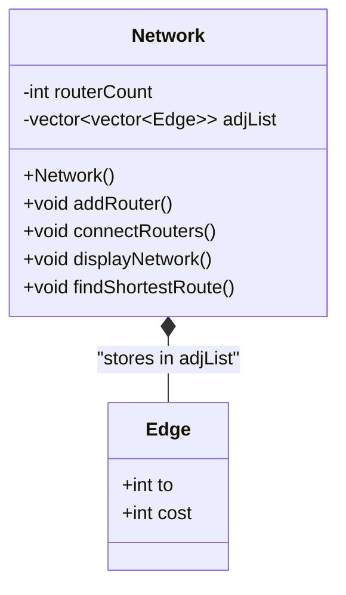

# NETROUTE SIMULATOR

A lightweight, beginner-friendly Object-Oriented C++ Network Routing Simulator written in standard C++17. Designed specifically for college Object-Oriented Programming (OOP) and Data Structures vivas and demonstrations.

---

## 1. Project Overview

**NetRoute Simulator** models a computer network of routers connected by bidirectional, weighted communication links. It allows users to:
1. Dynamically add routers with automatically assigned integer IDs (`1, 2, 3, ...`).
2. Establish communication links between routers with custom positive costs.
3. Visualize the entire network topology, including connected and isolated routers.
4. Calculate and display the optimal shortest path and minimum transmission cost between any two routers using **Dijkstra's Algorithm**.

The project uses clean Object-Oriented Programming (OOP) principles—specifically **Encapsulation**, **Data Hiding**, and **Abstraction**—while remaining simple, readable, and free of unnecessary enterprise abstractions.

---

## 2. Menu Options

The application presents a clean and simple menu:

```text
========================================
         NETROUTE SIMULATOR
========================================
1. Add Router
2. Connect Routers
3. Display Network
4. Find Shortest Route
0. Exit
========================================
Enter your choice: 
```

---

## 3. Features & Validation Rules

- **Option 1: Add Router**
  - Adds a new router node to the network.
  - Automatically generates an incremental integer ID (`1, 2, 3...`).
  - Resizes the adjacency list to accommodate new connections.

- **Option 2: Connect Routers**
  - Prompts for two router IDs and a link cost using direct `cin`.
  - Links are bidirectional (traffic flows both ways).
  - **Validation checks:**
    - Rejects IDs of routers that do not exist.
    - Rejects self-loops (connecting a router to itself).
    - Rejects non-positive link costs ($\le 0$).
    - Rejects duplicate connections between already connected routers.

- **Option 3: Display Network**
  - Displays each router along with its connected neighbors and link costs.
  - Clearly identifies isolated routers (`[No connections (Isolated)]`).

- **Option 4: Find Shortest Route**
  - Prompts for source and destination router IDs.
  - Uses Dijkstra's algorithm with an STL min-priority queue to compute the lowest-cost path.
  - Prints the complete hop sequence (e.g., `1 -> 2 -> 3`) and total cost.
  - Handles identical source and destination routers immediately with cost 0.
  - Detects unreachable destinations and displays `"No route exists between these routers."`.

- **Option 0: Exit**
  - Gracefully terminates the program.

---

## 4. Object-Oriented Architecture

The project is structured into three clean files:

```
NetRouteSimulator/
├── Network.h          # Edge struct and Network class declaration
├── Network.cpp        # Network class implementation & Dijkstra's algorithm
├── main.cpp           # Main function and menu loop
├── tests.cpp          # Automated basic verification tests
├── OOP_DESIGN.md      # OOP architecture and class diagram
└── README.md          # Project documentation and viva guide
```

### Class Structure:



### Component Breakdown:
1. **`struct Edge`**:
   - Represents a connection to a neighboring router with fields `to` and `cost`.
   - Uses a `struct` because it is a simple Plain Old Data record with no invariant logic to hide.

2. **`class Network`**:
   - Encapsulates the network state: `routerCount` and `adjList` are **`private`**.
   - Public member functions: `addRouter()`, `connectRouters()`, `displayNetwork()`, `findShortestRoute()`.

3. **`main()` function**:
   - Creates a `Network` object and runs the menu loop using standard `cin`, `cout`, `switch`, and `if-else`.

---

## 5. OOP Principles Explained

### Encapsulation & Data Hiding
In procedural code, `routerCount` and `adjList` were global variables accessible from anywhere. In this OOP refactoring:
- `routerCount` and `adjList` are made `private` data members inside `class Network`.
- External code cannot accidentally modify the router count or insert invalid edges directly into the adjacency list.
- All modifications are strictly controlled via public member functions.

### Abstraction
The `main()` function only interacts with high-level member functions:
```cpp
network.addRouter();
network.connectRouters();
network.displayNetwork();
network.findShortestRoute();
```
`main()` does not need to know that the network uses a 1-based `vector<vector<Edge>>` or how Dijkstra's min-heap relaxes edges.

### Why Inheritance and Polymorphism Are Not Needed
- **Inheritance** is used when modeling an "is-a" hierarchy between different types of objects. In this simulator, all routers and links are identical.
- **Polymorphism** is used when different objects respond differently to the same function call at runtime. Since there is only one graph model and one routing algorithm (Dijkstra), virtual functions would only add unnecessary complexity.

---

## 6. How Dijkstra's Algorithm Works

Dijkstra's algorithm finds the shortest path between a source router and all other routers in a weighted graph with non-negative edge weights:

1. **Initialization:**
   - Set distance to the source router as `0`.
   - Set all other router distances to infinity (`INF = 1,000,000,000`).
   - Push `(0, source)` into a min-priority queue (`priority_queue` with `greater<pair<int, int>>`).
2. **Min-Distance Selection:**
   - Extract the router `u` with the smallest tentative distance.
   - If `u` has already been visited, skip it. Otherwise, mark `u` as visited.
   - If `u` is the destination router, stop early.
3. **Edge Relaxation:**
   - For every neighbor `v` of `u` with link cost `w`:
     - If $\text{distance}[u] + w < \text{distance}[v]$, update $\text{distance}[v] = \text{distance}[u] + w$.
     - Set $\text{parent}[v] = u$ to remember how `v` was reached.
     - Push `(distance[v], v)` into the priority queue.
4. **Path Reconstruction:**
   - Starting from `destination`, trace backwards using the `parent` array until reaching `source`.
   - Reverse the sequence to obtain the path from source to destination.

---

## 7. Time and Space Complexity

| Operation | Time Complexity | Space Complexity |
| :--- | :--- | :--- |
| **Add Router** | $\mathcal{O}(1)$ amortized | $\mathcal{O}(1)$ |
| **Connect Routers** | $\mathcal{O}(\text{deg}(u))$ | $\mathcal{O}(1)$ |
| **Display Network** | $\mathcal{O}(V + E)$ | $\mathcal{O}(1)$ |
| **Find Shortest Route** | $\mathcal{O}((V + E) \log V)$ | $\mathcal{O}(V)$ auxiliary |

*$V$ = number of routers, $E$ = number of links, $\text{deg}(u)$ = number of connections attached to router $u$.*

---

## 8. Compilation & Execution Instructions

The project uses standard C++17 and standard libraries.

### Compile the Application:
```bash
g++ -std=c++17 -Wall -Wextra -Wpedantic main.cpp Network.cpp -o NetRouteSimulator
```

### Run on Windows:
```powershell
.\NetRouteSimulator.exe
```

### Run on Linux / macOS:
```bash
./NetRouteSimulator
```

### Run Automated Tests:
```bash
g++ -std=c++17 -Wall -Wextra -Wpedantic tests.cpp Network.cpp -o tests
.\tests.exe
```

---

## 9. Viva Questions and Answers

1. **Q: What OOP concepts did you implement in this project?**
   - **A:** Encapsulation and Data Hiding (private data members `routerCount` and `adjList` in `Network`), Abstraction (public interface separating how the network is used from its internal data structures), and Separation of Concerns (`main()` runs the menu while `Network` handles routing logic).

2. **Q: Why is `Edge` a struct and not a class?**
   - **A:** `Edge` is a simple data record that only holds two variables (`to` and `cost`). Since it has no private state or invariant logic to protect, using a `struct` with public members is clean and idiomatic C++.

3. **Q: Why didn't you create a separate `Router` class?**
   - **A:** In this simulation, routers only have integer IDs (`1, 2, ...`) without any unique state or methods. Creating a `Router` class would be a redundant wrapper around an integer without adding any architectural benefit.

4. **Q: Why are inheritance and polymorphism not used?**
   - **A:** All routers and links follow the exact same rules. There are no specialized subtypes (e.g., wireless routers) or alternative routing algorithms. Adding abstract classes or virtual functions would be unnecessary overengineering.

5. **Q: Why do we use `using namespace std;`?**
   - **A:** It imports all standard-library names into the global scope, allowing us to write clean and concise code like `cout`, `cin`, and `vector` instead of repeatedly prefixing `std::`.

6. **Q: What data structure is used to represent the network?**
   - **A:** An Adjacency List using `vector<vector<Edge>>`, where `adjList[u]` contains all connections attached to router `u`. It uses $\mathcal{O}(V + E)$ space, which is optimal for sparse network topologies.

7. **Q: Why is `priority_queue` declared with `greater`?**
   - **A:** By default, C++ `std::priority_queue` is a max-heap. In Dijkstra's algorithm, we need the router with the smallest distance first, so we pass `greater<pair<int, int>>` to make it a min-heap.

8. **Q: How does the program detect unreachable routers?**
   - **A:** All router distances are initialized to infinity (`INF = 1000000000`). If `distance[destination]` remains `INF` after Dijkstra's algorithm finishes, no path connects the source to the destination.
